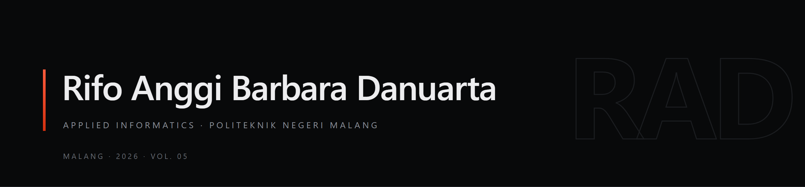

<!-- Banner: banner.png is a 2x raster of banner.svg (the vector source). Regenerate after editing the SVG. -->

 

| STATUS | FOCUS | NOW | BASED IN |
| :--- | :--- | :--- | :--- |
| Open to full-time internship · 2026 | Web & mobile engineering · Applied ML | Semester 5, D4 Teknik Informatika | Malang, East Java · WIB |

## 01 — About

I learn to build software by repeating: make, measure, fix. Most of my time sits between Laravel, Flutter, and SQL queries — building apps that are calm to use and honest about how they work.

<b>Read more</b> — English / Bahasa Indonesia

 

My interest started with a simple question — why one interface feels effortless and another exhausting. That led me to mobile engineering, then to machine learning, because many real problems need both at once: a model smart enough, and an app patient enough to explain it.

I am currently in my fifth semester of Applied Informatics at Politeknik Negeri Malang. Outside class, I take on projects that force me through the whole pipeline: from data structures to typographic detail.

---

Saya belajar membangun perangkat lunak dengan cara mengulang: bikin, ukur, perbaiki. Sebagian besar waktu saya habis di antara Laravel, Flutter, dan kueri SQL.

Ketertarikan saya mulai dari pertanyaan sederhana — kenapa satu antarmuka terasa mudah dan yang lain melelahkan. Dari situ saya masuk ke mobile engineering, lalu ke machine learning karena banyak masalah nyata butuh keduanya sekaligus: model yang cukup pintar dan aplikasi yang cukup sabar menjelaskannya.

Saat ini saya menempuh semester lima D4 Teknik Informatika di Politeknik Negeri Malang. Di luar kelas, saya mengerjakan proyek yang memaksa saya menyentuh seluruh alur: dari struktur data sampai detail tipografi.

## 02 — Selected Work

| Project | Year | Role | Stack |
| :--- | :---: | :--- | :--- |
| **[Sign.L](https://rifo.vercel.app)** | 2026 | Backend & Firebase Developer | Flutter · Provider · TensorFlow Lite · Firebase · Camera |
| **[JoinFest](https://rifo.vercel.app)** | 2026 | E-ticket & QR Scanner Developer | Laravel · Livewire · Tailwind · MySQL · Midtrans · QR |
| **[Lab DT](https://rifo.vercel.app)** | 2025 | Full-stack PHP Developer | PHP · PostgreSQL · Tailwind · Custom MVC |

Case studies and details on [rifo.vercel.app](https://rifo.vercel.app).

## 03 — Toolset

**Languages**

**Web**

**Mobile**

**Machine Learning**

**Databases**

**Tooling**

## 04 — GitHub

<picture>
  <source media="(prefers-color-scheme: dark)" srcset="https://github-readme-stats.vercel.app/api?username=Xyrfo&show_icons=true&hide_border=true&include_all_commits=true&count_private=true&bg_color=08090A&title_color=FF5C3D&text_color=EDEDEF&icon_color=FF5C3D">
  
</picture>
<picture>
  <source media="(prefers-color-scheme: dark)" srcset="https://github-readme-stats.vercel.app/api/top-langs/?username=Xyrfo&layout=compact&hide_border=true&langs_count=8&bg_color=08090A&title_color=FF5C3D&text_color=EDEDEF">
  
</picture>

## 05 — Contact

Open to full-time internships, freelance work, and applied research collaborations. I reply within 24 hours on weekdays.

- **Email** — [rofo.anggi18@gmail.com](mailto:rofo.anggi18@gmail.com)
- **LinkedIn** — [in/xyrfo](https://www.linkedin.com/in/xyrfo)
- **Portfolio** — [rifo.vercel.app](https://rifo.vercel.app)
